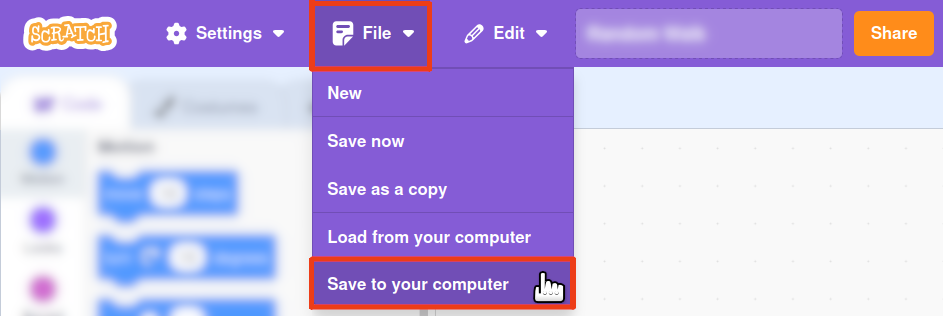

# scratch-worksheets

A web page for taking a Scratch app (a shared project on the Scratch website, or
an exported `sb3` file), separating the blocks and randomising the order, then
making a printable PDF worksheet with a title and some instructions.

Everything happens in the browser: an `sb3` file is not uploaded anywhere. The page
is plain static files, plus a small reverse proxy for the Scratch API (see
[Hosting](#hosting)).

## Process

1. Open the web page, and choose the app:
   - **Scratch project link:** paste the link of a shared project, e.g.
     `https://scratch.mit.edu/projects/1234567890`, or just its number. The
     project is downloaded from the Scratch website.
   - **Upload a file:** for a project that is not shared, save it to your
     computer, then choose (or drop) the `sb3` file:

     
1. Type a title (the default is the project's title, or the file's name), an optional level (e.g. `1`,
   `5B` or `10`, up to 4 characters, shown in a circle in the top-right corner of
   the worksheet), and the instructions. The
   instructions can use Markdown: paragraphs, `-` or `1.` lists, `**bold**`,
   `*italic*` and `## headings`.
1. Optionally, use **Shuffle again** for a different order of blocks (the same
   order number always gives the same order), or choose a block size. By default
   the blocks are as large as possible while still fitting on one page.
1. Click **Download PDF…**, and choose **Save as PDF** as the destination in the
   print window.

## How it works

Each script is split into single blocks: each block is disconnected from the
blocks before and after it, C-blocks are emptied, and reporters (such as
variables) are taken out of the inputs they were dropped into. Values typed into
blocks are kept. The blocks are shuffled, but each sprite's blocks stay together
under its name and picture.

The blocks are drawn by Scratch's own block library
([scratch-blocks](https://github.com/scratchfoundation/scratch-blocks), in
`web/vendor/`), then made print-friendly (cropped, black text, icons embedded).

| File | What it does |
| --- | --- |
| `web/index.html` | The page, and the worksheet's A4 page style |
| `web/js/app.js` | Wires the page together |
| `web/js/sb3.js` | Reads the `sb3` file (a zip file, read with [fflate](https://github.com/101arrowz/fflate)) |
| `web/js/scratchsite.js` | Downloads a shared project from the Scratch website |
| `web/js/splitter.js` | Splits the scripts into single blocks, and shuffles them |
| `web/js/render.js` | Draws the blocks with scratch-blocks |
| `web/js/printfriendly.js` | Makes each drawn block a standalone, print-friendly SVG |
| `web/js/markdown.js` | Converts the instructions from Markdown |
| `web/js/layout.js` | Lays out the worksheet and picks the block size |

## Hosting

Publish the contents of the `web` directory with a web server. The page uses
JavaScript modules, so it must be served over HTTP(S); opening `web/index.html`
straight from disk does not work.

To download a shared project, the page needs three things from Scratch:

1. the project's details, including its title and a token (valid for a few
   minutes) for downloading it, from `https://api.scratch.mit.edu/projects/<id>`,
2. the project, from `https://projects.scratch.mit.edu/<id>?token=<token>`,
3. the sprites' costume pictures, from `https://assets.scratch.mit.edu/`.

The project and asset servers let any web page read their replies, so the page
gets those itself. The Scratch API only lets `scratch.mit.edu` read its replies,
so the page asks its own web server for `scratch-api/projects/<id>` (relative to
the page), which must forward the request to the Scratch API.

For Apache, [deploy/apache-scratch2worksheet.conf](deploy/apache-scratch2worksheet.conf)
does this for a page served from `/scratch2worksheet/`: include it in the site's
`<VirtualHost>` (instructions are in the file). It only forwards project numbers,
so it is not an open proxy, and it doesn't pass on visitors' cookies. It also
makes browsers check for new versions of the page's files, so they don't keep
using old ones after an update.

Without the proxy, the "Upload a file" tab still works.

## Development

- `make web-test` serves the page at <http://localhost:8080/>, with the proxy for
  the Scratch API, and tells browsers not to cache the files (needs Python 3).
- `make test` runs the unit tests (needs Node.js).
- `make e2e-test` makes a worksheet for each app in `apps/` in headless Chromium
  and headless Firefox, checks the blocks and the level circle, and saves the PDFs
  in `build/e2e/<browser>/` (needs Node.js, Chromium, and Firefox with
  [geckodriver](https://github.com/mozilla/geckodriver)). `make e2e-chromium` and
  `make e2e-firefox` test one browser. Set `CHROMIUM`, `FIREFOX` or `GECKODRIVER`
  to use other browser binaries. An app is a `.sb3` file or a folder containing
  `project.json`; its title and instructions come from a Markdown file of the same
  name, e.g. `apps/RandomWalk.md`, whose first `# ` heading is the title. Random
  Walk is also loaded from its link on the Scratch website, which needs the
  internet (set `E2E_OFFLINE=1` to skip it). To test a deployment instead of a
  local server, set `E2E_URL`, e.g.
  `E2E_URL=https://www.ashleygc.co.uk/scratch2worksheet/ make e2e-test`.

The fixtures in `tests/fixtures/` were made by the original Python version of this
program, which the web page replaces, so the tests check the page splits blocks,
converts Markdown and draws blocks just as it did.
